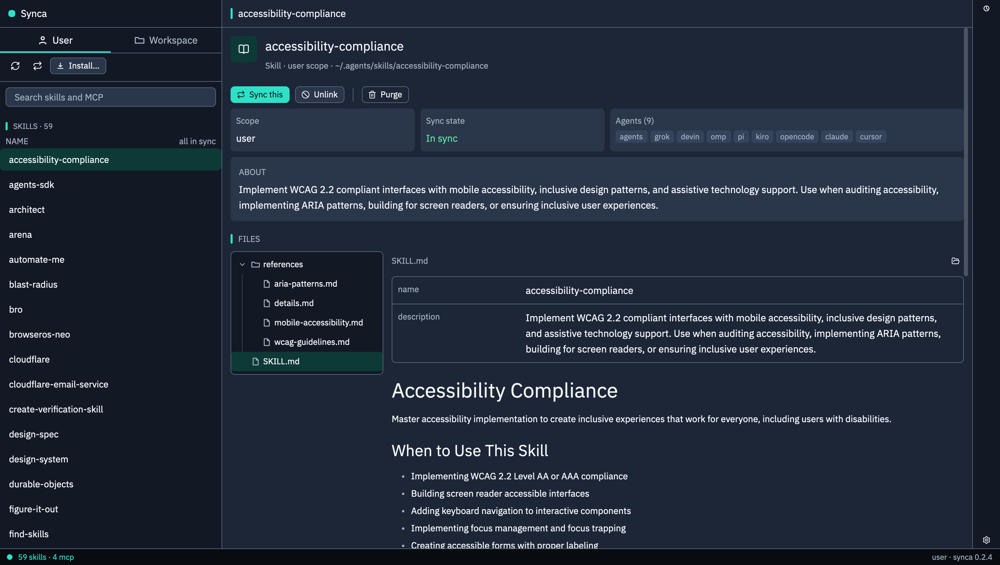
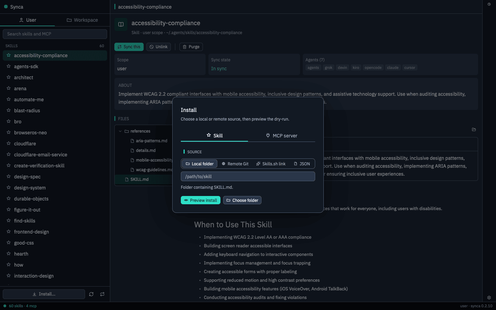
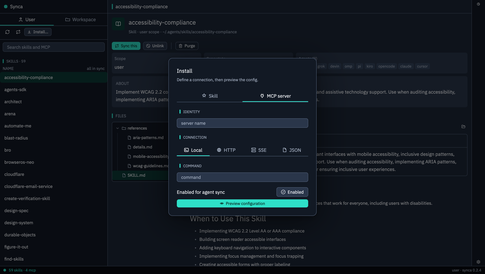
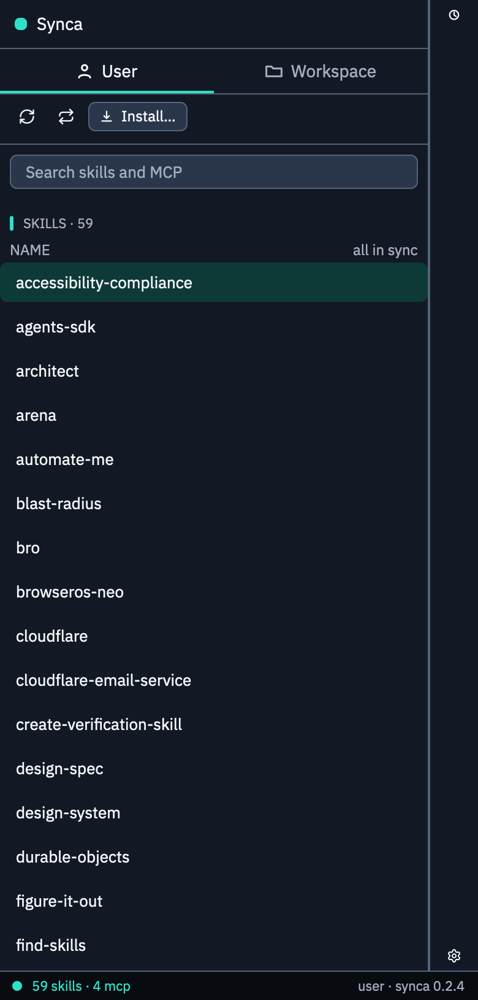

<p align="center"></p>

# synca

Browse and sync **skills** + **MCP** configs across coding agents (Grok, Devin, Kiro, OpenCode, Claude, Cursor) from one CLI. Pi (`~/.pi`) and OMP (`~/.omp`) are not targets. Directories that already exist for them are ignored and never deleted.

The CLI is the source of truth and the only writer. The window is `synca-gpui` in the sibling repo [`ns-gpui`](#window). There is no daemon or background service.

## Screenshots

The window, driven by the CLI (`synca-gpui`, dark theme).



Main view (1440×900): User and Workspace scopes, search, and the skill and MCP server list on the left, with Install… and the sync actions pinned at the bottom; the selected entry's scope, sync state, agents, files and markdown preview on the right.



The Install dialog, Skill tab: pick a local folder, remote Git source, skills.sh link or JSON, then preview the dry-run before anything is written.



The MCP server tab of the same dialog: name the server, choose a local process, HTTP, SSE or a JSON config, then preview the normalized config.



A skill detail in a narrow (390 pt) window: the list and the detail become separate screens (the back arrow returns to the list), and the Install dialog fills the window.

## Install

### From GitHub Release (recommended)

macOS arm64 only. Asset name: `synca-vX.Y.Z-darwin-arm64`. `SHA256SUMS` is for a manual check. `synca update` verifies the GitHub asset digest instead.

```bash
TAG=v0.2.9
ASSET=synca-${TAG}-darwin-arm64
VER=${TAG#v}
mkdir -p ~/.local/share/synca/bin ~/.local/bin
curl -fsSL -o ~/.local/share/synca/bin/synca-$VER \
  "https://github.com/ngosangns/synca/releases/download/${TAG}/${ASSET}"
chmod 755 ~/.local/share/synca/bin/synca-$VER
ln -sfn ../share/synca/bin/synca-$VER ~/.local/bin/synca
```

Make sure `~/.local/bin` is on `PATH`. Then self-update later:

```bash
synca update --check
synca update
```

### From source

Needs Go (version in `go/go.mod`) and, for the `task` commands, [go-task](https://taskfile.dev).

```bash
git clone https://github.com/ngosangns/synca.git
cd synca
task install        # builds, copies to ~/.local/share/synca/bin/synca-<VERSION>, links ~/.local/bin/synca
```

`task install` runs `make install` in `go/`, so `cd go && make install` does the same without `task`.

| Task | What it does |
| --- | --- |
| `task install` | Same as `task cli:install` |
| `task cli:build` | Build `go/bin/synca` only |
| `task cli:install` | Build, install to `~/.local/share/synca/bin`, link `~/.local/bin/synca` |
| `task test` / `task cli:test` | `go vet ./...` and `go test ./...` |
| `task release:build` | Test and build `dist/synca-vX.Y.Z-darwin-arm64` plus `SHA256SUMS`. No publish |
| `task release:publish` | Same, then `gh release create` or upload for the `VERSION` file. Asks first |
| `task dev:install` | Build the window from `../ns-gpui` and install `Synca Dev.app` into `~/Applications` |
| `task dev:install:all` | `task install`, then `task dev:install` |

The version lives in the root `VERSION` file and must match `Version` in `go/internal/core/models.go`; the release script and CI refuse a tag that does not match. CI (`.github/workflows/ci.yml`) vets, tests and builds the CLI. `release.yml` builds the asset on a `v*` tag push.

## Usage

```bash
synca                 # print help (same as synca help)
synca --version       # synca 0.2.9
```

```text
synca skills <list|install|remove> [flags]
synca mcp <list|add|remove> [flags]
synca sync <skills|mcp|all> [flags]
synca provider clear <name> [--scope --cwd --yes --dry-run --json]
synca doctor [--scope --cwd --json]
synca skill <install|check> [--dest DIR] [--json]
synca update [--check] [--json] [--force]
synca version [--json]
synca schema [--json] [<command>]
```

### Common flags

| Flag | Meaning |
| --- | --- |
| `--scope user\|project` | Default `user`. `project` needs a git repo (see [Scope](#scope)) |
| `--cwd <dir>` | Where to look for the project root. Default `.` |
| `--agents a,b,c` | Restrict to these agents. Unknown names are ignored; an empty result means all agents |
| `--dry-run` | Print the plan and change nothing |
| `--json` | One JSON document on stdout. Every command accepts it |
| `--yes` | Confirm a destructive command. Required off a TTY for `skills remove --purge`, `mcp remove`, and `sync` with `keep-source` or `keep-target`. `provider clear` requires it even on a TTY |
| `--on-conflict skip\|keep-source\|keep-target` | `sync` only. Default `skip`. `skip` exits 0 and reports conflicts. `keep-source` and `keep-target` overwrite and need `--yes` off a TTY |
| `--key <name>` | `sync skills` and `sync mcp` only. `sync all` rejects it |

Flags take `--flag value` or `--flag=value`.

### List

```bash
synca skills list --scope user
synca skills list --scope project --json
synca mcp list --scope user
synca mcp list --json
```

Text output is one line per entry with the agents that have it, and `MISMATCH` when copies differ. It does not print env values. `mcp list --json` does: every env value is `••••••` unless you pass `--reveal`. A URL password and a secret-looking arg are masked the same way. The fingerprint still comes from the real config.

### Skills

```bash
synca skills install ./my-skill --scope user
synca skills install vercel-labs/agent-skills --scope user
synca skills install https://skills.sh/vercel-labs/agent-skills/find-skills --dry-run
synca skills install https://github.com/org/skill-repo.git --dry-run
synca skills remove my-skill                  # unlink agents, keep the canonical copy
synca skills remove my-skill --purge          # also delete canonical; asks you to retype the name
synca skills remove my-skill --purge --yes
```

`install` takes a source and copies the skill into the canonical dir, then links it into each agent dir:

- a local folder with `SKILL.md`, or a folder that holds exactly one skill folder (it also looks in `.agents/skills`);
- `owner/repo` shorthand (GitHub);
- a Git URL (`https://github.com/...`, `gitlab.com`, `git@...`, anything ending in `.git`);
- a `https://skills.sh/<owner>/<repo>/<skill>` URL.

Remote sources are cloned with `git clone --depth 1` into a temp dir that is removed afterwards. `git` must be installed. A skill's key is its `SKILL.md` `name`, not the folder name; `remove` works on that key.

### MCP servers

```bash
synca mcp add my-server --transport stdio --command "npx -y @pkg/server"
synca mcp add hosted-server --transport http --url https://example.com/mcp
synca mcp add stream-server --transport sse --url https://example.com/sse
synca mcp remove my-server --scope user --dry-run
synca mcp remove my-server --scope user --yes
```

`mcp add` and `mcp remove` both accept `--dry-run`. `mcp remove` deletes the server from the hub and from agent configs, so off a TTY it exits 6 unless you pass `--yes`.

`mcp add` flags: `--transport stdio|http|sse` (default `stdio`; `local` means stdio, `remote` means http), `--command` (required for stdio, split like a shell line), `--url` (required for http and sse), `--env KEY=VAL` (repeatable; the plan shows the key with the value masked), `--enabled true|false`. `sse` is kept only when the URL ends in `/sse`; otherwise the server is stored as `http`.

### Sync

```bash
synca sync skills --scope user --dry-run
synca sync mcp --scope user --dry-run
synca sync all --scope user --dry-run
synca sync skills --scope user --on-conflict skip
synca sync all --scope user --on-conflict keep-source --yes
synca sync mcp --scope user --on-conflict keep-target --yes
synca sync skills --dry-run --json
```

Run with `--dry-run` first. The text plan is one compact JSON object per line. `--json` prints one document instead: `dryRun`, `scope`, `onConflict`, `actions` (those same objects), and `conflicts` (`skill`, `key`, `policy`). An apply adds `applied` and sets `dryRun` to false. Without `--json` the text is unchanged.

Action kinds: `ensure_canonical_copy`, `symlink_skill`, `ensure_mcp_hub`, `write_mcp_server`, `skip_same`, `skip_mcp_same`, `conflict_skill`, `conflict_mcp`. `ensure_mcp_hub` is an idempotent upsert and shows up even when the hub is already correct.

| `--on-conflict` | Behavior |
|-----------------|----------|
| `skip` (default) | Leave conflicting entries untouched and exit 0. On a TTY, a non-dry run with conflicts asks once for `skip`, `keep-source` or `keep-target` |
| `keep-source` | Prefer canonical / Agents (or first) content; overwrite others + symlink/write. Needs `--yes` off a TTY |
| `keep-target` | Prefer the first agent copy whose content differs from the source; promote it to the hub and sync out. Needs `--yes` off a TTY |

Never silent overwrite. A dry-run does not need `--yes`.

### Providers

```bash
synca provider clear kiro --dry-run
synca provider clear kiro --scope user --yes
```

Deletes one agent's skill copies and MCP server entries in the scope. It refuses without `--yes` (unless `--dry-run`) and exits 6, including on a TTY. It never touches the canonical hub, and only removes the MCP server table or key from the agent's config, not the rest of the file. `agents` is not a valid provider. `--json` prints `{dryRun, scope, provider, lines}` where `lines` are the same strings as the text output.

### Update

```bash
synca update --check          # report only
synca update --check --json
synca update                  # install the latest release
synca update --force          # reinstall the current version
```

Details:

- darwin-arm64 only.
- Replaces only a binary installed as `~/.local/share/synca/bin/synca-<ver>` (or the regular file `~/.local/bin/synca`). It refuses other binaries and anything inside an `.app` bundle.
- The release asset must carry a GitHub SHA-256 digest; a sidecar checksum file is not accepted. It refuses a downgrade.
- Uses `GITHUB_TOKEN`, `GH_TOKEN` or `gh auth token` when available, to avoid API rate limits.
- Exit status: 1 for a failed update, 2 for bad arguments. Other commands use the contract codes below. `update` does not.

### Doctor

```bash
synca doctor
synca doctor --json
```

Read-only. Reports a real agent skill directory whose content differs from canonical, dangling symlinks, missing links in agent skill directories that exist, and MCP entries that differ between the hub and an agent config. Exit 0 when clean, 8 when anything differs. An agent with no skills directory or no MCP file is not reported. Pi and OMP are not inspected.

### Bundled skill

```bash
synca skill install
synca skill check
synca skill check --json
```

`skill install` writes the embedded copy of `skills/synca` (the source of truth in this repo). The default destination is `~/.agents/skills/synca`. `skill check` exits 0 when that directory matches, 8 when it has drifted, and 3 when it is missing.

### Exit codes

| Exit | When |
| --- | --- |
| 2 | Usage: unknown flag, bad argument, unknown command |
| 3 | Unavailable: missing path or source, or no git root for `--scope project` |
| 5 | The operation failed |
| 6 | A destructive command had no `--yes` off a TTY |
| 8 | `doctor` or `skill check` found drift |

With `--json`, a failure prints one line on stdout: `{"error":{"code","exit","message","hint"}}`. Without `--json`, stderr stays `synca failed: ...` plus an optional `hint:` line. `sync --on-conflict skip` exits 0 and still lists conflicts. Every `--help` / `-h` exits 0.

## Where things live

### Scope

- `user` (default): `~/.agents/...` plus per-agent home dirs.
- `project`: `<git-root>/.agents/...` plus repo-local agent dirs. The git root is the nearest parent of `--cwd` that contains `.git`. Outside a repo, `list` shows nothing and `install`, `add` and `remove` fail with "no project root".

### Canonical paths

| | User | Project |
| --- | --- | --- |
| Skills | `~/.agents/skills/<name>/` | `<git-root>/.agents/skills/<name>/` |
| MCP hub | `~/.agents/mcp.json` | `<git-root>/.mcp.json` |

Sync prefers **symlinks** from each agent's skills dir to the canonical dir. An agent dir that is itself a symlink to the canonical dir is left alone. MCP writers translate to each agent's format (JSON, Grok TOML, OpenCode `mcp` key) and preserve existing **env secrets** on the target when the source lacks a key.

### Agent paths

Skills dirs (`<root>` is `~` for user scope, `<git-root>` for project scope):

| Agent | User | Project |
| --- | --- | --- |
| Grok | `~/.grok/skills` | `.grok/skills` |
| Devin | `~/.config/devin/skills` | `.devin/skills` |
| Kiro | `~/.kiro/skills` | `.kiro/skills` |
| OpenCode | `~/.config/opencode/skills` | `.opencode/skills` |
| Claude | `~/.claude/skills` | `.claude/skills` |
| Cursor | `~/.cursor/skills` | `.cursor/skills` |

MCP config files:

| Agent | User | Project |
| --- | --- | --- |
| Grok | `~/.grok/config.toml` | `.grok/config.toml` |
| Devin | `~/.config/devin/mcp_config.json` | none |
| Kiro | `~/.kiro/settings/mcp.json` | `.kiro/settings/mcp.json` |
| OpenCode | `~/.config/opencode/opencode.json` | `opencode.json` |
| Claude | `~/.claude.json` | none |
| Cursor | `~/.cursor/mcp.json` | `.cursor/mcp.json` |

## Window

The window is the `synca-gpui` crate in the sibling repo `ns-gpui` (clone it next to this repo). It shells out to `~/.local/bin/synca` (or `synca` on `PATH`), so install the CLI first.

```bash
task dev:install      # builds ../ns-gpui and installs ~/Applications/Synca Dev.app
# or, from ns-gpui:
cargo run --release -p synca-gpui
```

What it does, all through the CLI:

- User scope or a project (workspace) scope; a project folder list is remembered.
- Library of skills and MCP servers with search, sync state per entry, and agent chips.
- Skill detail with a file tree and Markdown preview; Sync this, Unlink, Purge.
- One **Install…** button opens one dialog with two tabs: **Skill** (local folder, remote Git source, skills.sh, JSON) and **MCP server** (local process, HTTP, SSE, JSON). Each tab keeps what you typed when you switch; ⌘1 and ⌘2 switch tabs, Left and Right move between them when the tab row has focus, and Escape closes the dialog.
- Sync runs a `--dry-run` first and shows the plan; conflicts can be skipped or resolved per entry.
- Activity panel (command log) and Settings panel: turn agents on or off, delete one agent's data (`provider clear`), check for updates.

Window state is stored in the macOS defaults domain `com.ngosangns.synca` (`synca.projects`, `synca.projectDir`, `synca.disabledProviders`). The activity log is `~/Library/Application Support/synca/command-log.jsonl`. A disabled agent is excluded by passing `--agents` to every command. The CLI itself reads no config file.

## Agent skill

`skills/synca/SKILL.md` is a skill that teaches coding agents to use this CLI instead of hand-editing agent dirs. Install it with:

```bash
synca skill install
```

## Agents

Grok, Devin, Kiro, OpenCode, Claude, Cursor (+ canonical `agents`). Pi and OMP are ignored.

## License

MIT
