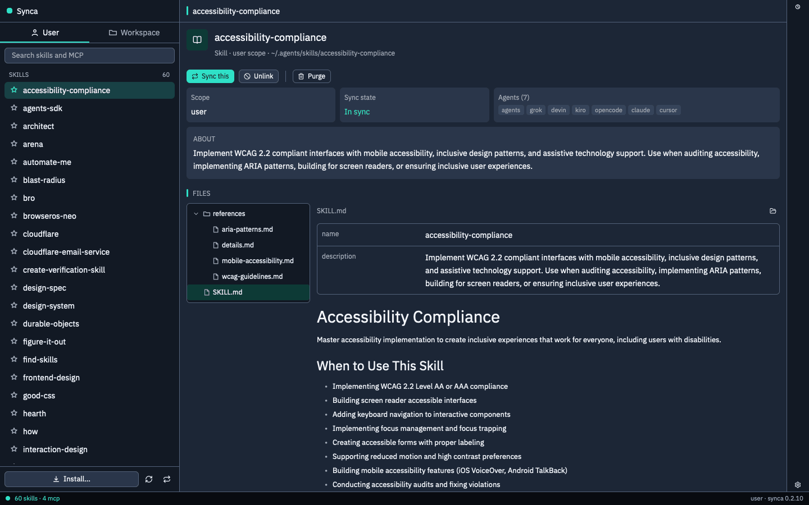

# synca-gpui

Synca lists skills and MCP servers for the user scope or a project scope. The detail surface groups identity, sync state, scope, agent availability, and description before the file explorer and markdown preview. It keeps the Swift app's project list and activity log. One Install… button opens one dialog with a Skill tab and an MCP server tab (⌘1 and ⌘2 switch; each tab keeps its fields; Escape closes). Install, add MCP, sync, unlink, purge, remove, provider delete, and update go to the synca CLI. A dry-run is shown before apply, and conflict lines can be skipped or kept.

The window links the shared chrome crate `ns-ui` from the `ns-gpui` repo and calls the installed `synca` CLI. Build and install the Dev app with `../ns-gpui/scripts/install-dev.sh synca`; run it from cargo with `cargo run --release` in this directory. Dev control (`ns-dev synca …`) is described in `ns-gpui/docs/dev-channel.md`.

Synca: User and Workspace scopes, a search box over skills and MCP servers, Install… and sync actions pinned at the bottom of the sidebar, and the selected entry's scope, sync state, agents, files and markdown preview. More in the [synca README](https://github.com/ngosangns/synca#readme).
